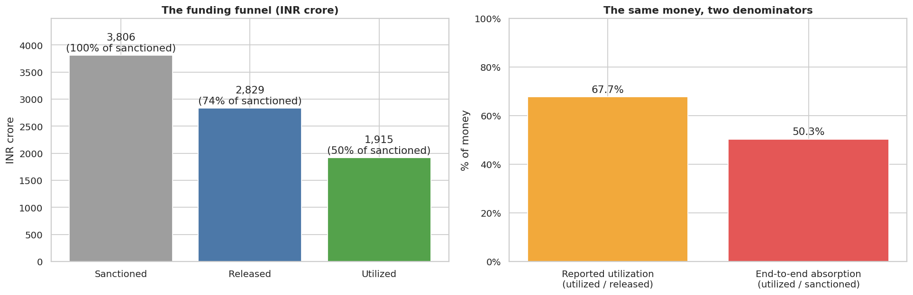
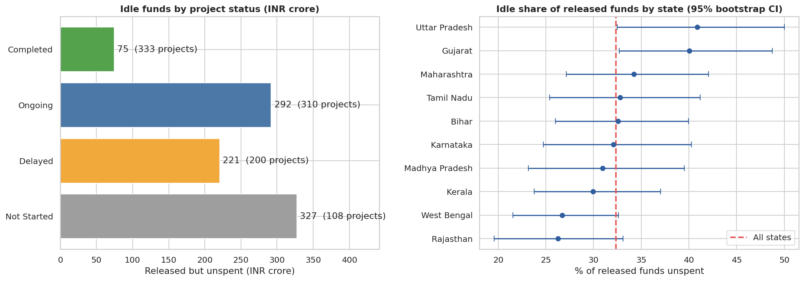
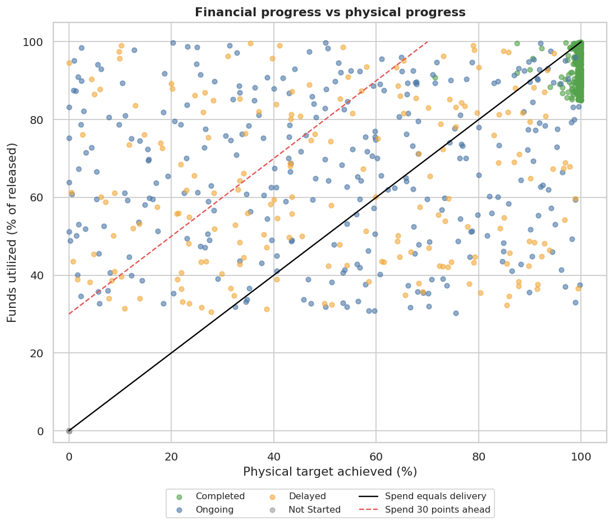
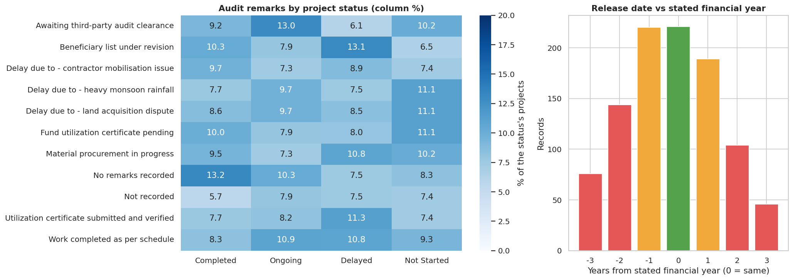
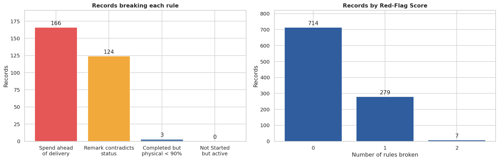
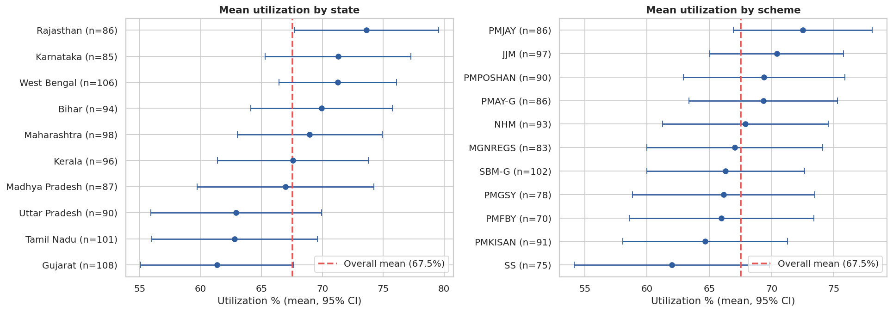
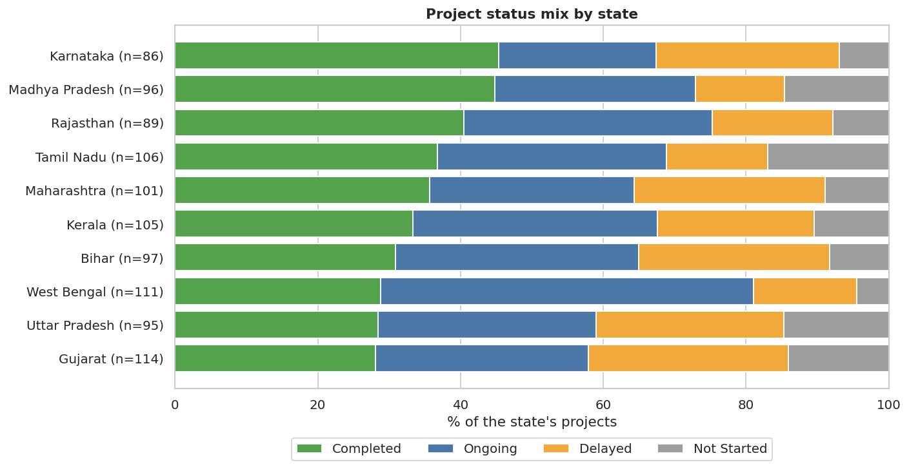
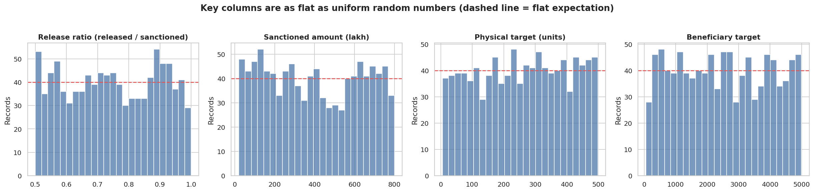
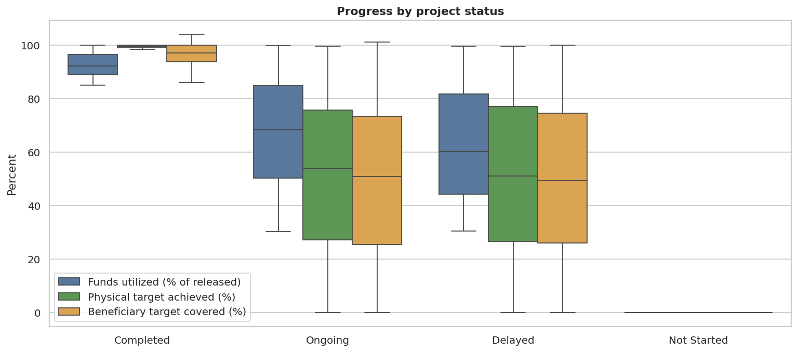

# 🏛️ Where Does Public Money Get Stuck?

### An audit-style analysis of government scheme funds

Measures the sanction-to-spend pipeline across **1,000 central-scheme fund records**, tests what explains the gaps, and builds a transparent **Red-Flag Screen** that shortlists records for audit review.

---

## At a glance

| 🧮 Reported utilization | 🧱 Real absorption | 💤 Idle released funds | 🚩 Spend-ahead projects |
|:---:|:---:|:---:|:---:|
| **67.7%** of released funds | **50.3%** of sanctioned funds | **₹915 crore** (32.3% of released) | **166** projects >30 points ahead of delivery |

**Notebook:** [`govt_fund_utilization_audit.ipynb`](govt_fund_utilization_audit.ipynb)

> **Read this first:** the dataset looks synthetic (key columns are almost perfectly uniform), so findings describe *this file*, not the real performance of any state, scheme or agency. The value of the project is the workflow, which transfers to real fund-tracking data. Amounts are in ₹ crore (1 crore = 100 lakh).

## Contents

[Key findings](#key-findings) · [The denominator trap](#the-denominator-trap) · [Where money sits idle](#where-money-sits-idle) · [Spending ahead of delivery](#spending-ahead-of-delivery) · [Can the records be trusted?](#can-the-records-be-trusted) · [Red-Flag Screen](#original-feature-red-flag-screen) · [What explains utilization](#what-explains-utilization) · [Data cleaning](#data-cleaning) · [Limitations](#limitations) · [Dataset](#dataset)

---

## Key findings

| # | Finding |
|:-:|---|
| 1 | **The headline utilization figure overstates absorption.** Reported utilization divides spending by money *released*. Against money *sanctioned*, projects spent only **50.3%**, because only 74.4% of sanctioned money was ever released. |
| 2 | **₹915 crore is released but unspent.** 35.8% of it (₹327 crore) sits in **108 projects that have not started**. |
| 3 | **Utilization follows project status and nothing else.** Completed projects average 92.6%, Ongoing 67.1%, Delayed 63.0%, Not Started 0%. No scheme, ministry, state, agency, fund source or year differs (all Kruskal-Wallis p > 0.3). |
| 4 | **In-flight projects spend ahead of delivery:** Ongoing by 15.4 points, Delayed by 11.7. **166 projects (₹489 crore released)** are more than 30 points ahead; 80 are more than 50. |
| 5 | **Audit remarks and release dates cannot be trusted.** Remarks are unrelated to status (p = 0.514); only 22.1% of release dates fall inside the stated financial year. |
| 6 | **The Red-Flag Screen** flags 28.6% of records at least once but only **7** twice, giving reviewers a short Tier 1 list. Flag rates do not differ by state or agency, so the problems look systemic. |

---

## The denominator trap

The file's `Utilization_Percent` is **utilized ÷ released**, which I confirmed by recomputing it (largest difference 0.005). That ignores money sanctioned but never released.

| Measure (951 records with spending recorded) | Value |
|---|---:|
| Sanctioned | ₹3,806 crore |
| Released | ₹2,829 crore (74.4% of sanctioned) |
| Utilized | ₹1,915 crore |
| **Reported-style utilization** (utilized ÷ released) | **67.7%** |
| **End-to-end absorption** (utilized ÷ sanctioned) | **50.3%** |

Both figures are worth reporting: one says how well released money is used, the other how much of the sanction has reached the ground.

---

## Where money sits idle

| Status | Projects | Idle funds (₹ crore) | Share of all idle money |
|---|---:|---:|---:|
| Not Started | 108 | 327 | **35.8%** |
| Ongoing | 310 | 292 | 31.9% |
| Delayed | 200 | 221 | 24.1% |
| Completed | 333 | 75 | 8.2% |

The first call for a monitoring team is the **not-started projects holding released funds**. State differences in idle share (Rajasthan 26.3% to Uttar Pradesh 40.9%) are within what chance produces: shuffling the state labels gives a spread this large about one time in six.

---

## Spending ahead of delivery

<table>
<tr>
<td width="52%"></td>
<td width="48%" valign="top">

A healthy project spends in step with what it builds. Points **above the diagonal** have spent more than they delivered.

| Status | Spend minus delivery |
|---|---:|
| Ongoing | **+15.4** pts |
| Delayed | **+11.7** pts |
| Completed | −6.7 pts |

- **166 projects** are >30 points ahead (₹489 crore released)
- **80 projects** are >50 points ahead (₹206 crore)

A gap is not wrongdoing (advance payments are often legitimate), so these are records to look at, not conclusions.

</td>
</tr>
</table>

---

## Can the records be trusted?

- **Audit remarks look random.** They are statistically unrelated to status (chi-square p = 0.514). 91 Completed projects (26.1%) carry a "Delay due to..." remark, nearly the same share as Delayed projects (24.9%), and 33 of the 98 projects marked "Work completed as per schedule" are Delayed or Not Started.
- **Release dates do not match the financial year.** Only 22.1% fall inside the stated year and 37.0% are two or more years away. Half of the 2021-22 records were released two or more years after the year ended.

---

## Original feature: Red-Flag Screen

A transparent rule-based checklist. Each rule is verifiable by a reviewer, and a record's **Red-Flag Score** is the number of rules it breaks.

| Rule | Records flagged |
|---|---:|
| Spending more than 30 points ahead of physical progress | 166 |
| Audit remark contradicts project status | 124 |
| Marked Completed but physical achievement below 90% | 3 |
| Marked Not Started but shows spending, output or beneficiaries | 0 |

Of 1,000 records, **714 have no flag, 279 have one and 7 have two**. The notebook lists Tier 1 (two or more flags) and Tier 2 (the largest releases among projects >50 points ahead), without any officer contact details.

---

## What explains utilization?

<table>
<tr>
<td width="50%"></td>
<td width="50%"></td>
</tr>
</table>

**Nothing structural.** Every Kruskal-Wallis p-value is above 0.3 (state 0.323, scheme 0.842, ministry 0.654, agency 0.687, fund source 0.482, year 0.540). States differ only in their **status mix** (chi-square p = 0.000, Cramér's V 0.14), mainly West Bengal with 52.3% of projects Ongoing against 33.0% overall.

<b>Does the data look real? (it does not)</b>

 

Release ratio (exactly 0.50 to 1.00), sanctioned amounts, physical targets and beneficiary targets are all consistent with uniform random numbers (Kolmogorov-Smirnov p = 0.662, 0.100, 0.438, 0.898). Together with the perfect link between status and utilization, the dataset looks simulated.

<b>Status vs progress chart</b>

 

---

## Data cleaning

<b>What was found and how it was handled</b>

 

| Issue | What was found | How it was handled |
|---|---|---|
| Inconsistent district text | 193 values with stray spaces and 115 not capitalised consistently: **181 distinct values for 50 real districts** | Trimmed and standardised capitals |
| Remarks with stray spaces | 172 values; 20 apparent remarks for 10 real ones | Trimmed |
| Financial year vs release date | Only 22.1% inside the stated year, 37.0% two or more years away | Flagged; no trend over financial years is claimed |
| Missing values | 60 utilization, 25 physical, 45 beneficiary, 70 remark blanks | Blanks on **Not Started** rows set to zero (all recorded Not Started rows are exactly zero); other blanks left missing, never treated as zero |
| Utilization denominator | `Utilization_Percent` = utilized ÷ **released** | Added end-to-end absorption (utilized ÷ sanctioned) |
| Over-coverage | 103 records above beneficiary target, at most 104.1% | Kept: mild, not an error |
| Personal data | `Nodal_Officer_Contact` holds names and e-mail addresses | Dropped; never displayed |

## Limitations

- **The data look synthetic**, so no finding describes real schemes, states or agencies.
- Utilization is measured against released funds; the file has no sanction date, release schedule or delay in days.
- Blanks remain for running projects (49 utilization, 21 physical, 39 beneficiary values); money analyses use the 951 records with recorded utilization.
- The Red-Flag Screen uses judgement thresholds (30 points, 90%), and a flag means "check this record", not "this record is wrong".
- About 100 records per state, so state-level differences are noisy.

## Dataset

- **File used:** `govt_fund_utilization.csv` (1,000 records, 21 columns: fund amounts in lakh rupees, status, audit remarks, physical and beneficiary targets).
